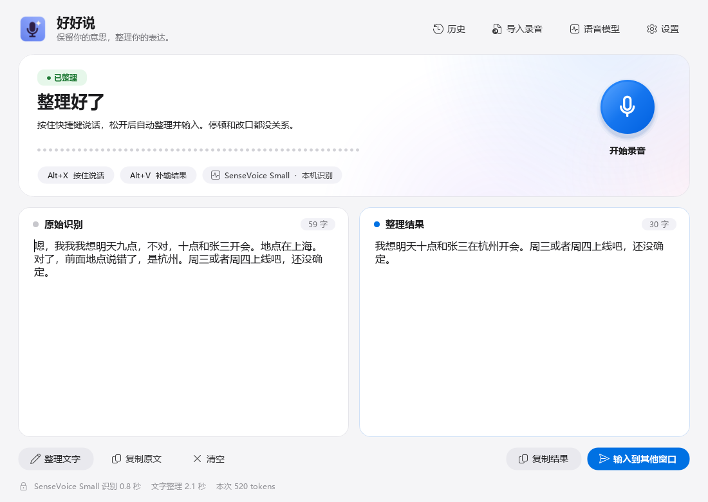

# 好好说 Saywell

**按住说话，松开就是一段干净的文字。**

好好说（Saywell）是一款 Windows 语音输入工具。它在你的电脑上识别声音，再用你选择的 AI 服务去掉“嗯、那个、我我我”和说错又改口的部分，保留你的原意和语气，然后把文字直接输入到光标所在的位置。

## 它能做什么

- **去掉口头禅和结巴**：填充词、无意义的重复会被清理掉。
- **听懂改口**：“明天九点，不对，十点开会”会变成“明天十点开会”。
- **不改你的意思**：否定、强调、“还没确定”这类表达会原样保留；它只整理文字，不会替你回答问题或执行命令（结尾的翻译要求除外）。
- **说完顺手翻译**：最后加一句“翻译成英文”（或日语、韩语……），输入的就是整理好的译文。
- **哪里都能输入**：聊天软件、文档、浏览器、终端都可以。结果是一行文字，不会自动按回车发送。
- **录音留在本机**：声音在你的电脑上识别，只有识别出的文字会发给你选的 AI 服务。

## 下载安装

1. 打开 [Releases 页面](https://github.com/hyt0019/saywell/releases)，下载最新版本的安装包并运行。
2. 如果 Windows 提示“Windows 已保护你的电脑”，这是因为程序暂未购买代码签名证书。点击“更多信息”→“仍要运行”即可。

需要 Windows 10 / 11（64 位）、一个麦克风，以及网络连接（首次下载语音模型和整理文字时使用）。

## 第一次使用

1. **填写 AI 服务**：打开好好说，点击右上角“设置”，填写 API 地址、API Key 和模型名称后保存。默认是 [DeepSeek](https://platform.deepseek.com/)，也可以使用其他兼容 OpenAI Chat Completions 接口的服务。整理文字的费用由你选择的服务商收取。
2. **下载语音模型**：点击“下载语音模型”，默认模型约 240 MB，只需下载一次。国内网络会自动走镜像；实在下载不了，可以用网盘等处的模型包在“语音模型”窗口里“导入”，或直接把模型文件夹放进下载位置。
3. **允许麦克风**：在 Windows“设置 → 隐私和安全性 → 麦克风”中，允许桌面应用访问麦克风。

## 日常使用

点一下要输入文字的地方 → **按住键盘右边的 `Ctrl` 键说话** → 说完松开。几秒后，整理好的文字就会出现在光标处。

| 快捷键 | 作用 |
|---|---|
| 按住右 `Ctrl` | 约 0.3 秒后开始听，说完松开，自动整理并输入 |
| `Esc` | 取消这次录音或处理 |
| `Alt+V` | 文字没输进去时，回到输入框按一下补输 |

- 说话时可以停顿、重复、改口，停顿不会自动结束录音。单次最长 2 分钟。
- 录音时屏幕下方只出现一个小状态条，不会打断你正在用的软件。
- 关闭主窗口后程序会留在系统托盘；右键托盘图标选择“退出”才会结束。
- 轻按右 Ctrl，或用它和其他键组合（如右 Ctrl+C），仍是原来的功能，不会录音。
- 快捷键可在设置中更换：可以选右 Alt、CapsLock、Alt+X 等，也可以自定义组合键（如 Ctrl+Alt+K）或 F1–F24；还可以改成“按一下开始，再按一下结束”。从旧版本升级会保留原来的快捷键。

## 看看你说了多少

主窗口的“概览”页记录你的使用情况：今天说了多少字、连续用了几天、累计字数和大约省下的打字时间；一张类似 GitHub 活跃图的热力图显示过去一年每天说了多少；还有 API 请求次数、tokens、估算花费（使用 DeepSeek 时显示账户余额），以及累计字数和连续使用天数的里程碑。统计只在本机记录字数、次数和 tokens，不记录说话内容，可以在设置中关闭或清空。原文和整理结果的对照编辑在“文字”页。

## 选择语音模型

点击主窗口的“语音模型”，可以一键下载、切换不同的本地识别模型，也可以选择模型的保存位置。所有模型都在本机运行。精选模型适合日常听写：

| 模型 | 大小 | 60 秒语音约 | 适合 |
|---|---|---|---|
| SenseVoice Small（默认） | 约 240 MB | 0.9 秒 | 以中文为主，自带标点 |
| X-ASR 中英 | 约 180 MB | 0.8 秒 | 中文里夹英文单词较多，体积最小 |
| Qwen3-ASR 0.6B | 约 1.1 GB | 4.2 秒 | 中文准确，嘈杂环境也较稳，自带标点；一句话约 1 秒出字；支持 GPU 加速 |
| Canary 180M Flash | 约 210 MB | 3.6 秒 | 说英文（也支持德、法、西班牙语）；不识别中文 |

表中速度是在 CPU 上测的。**GPU 加速**：电脑有独立显卡时，可以在“设置 → GPU 加速”中开启，用显卡运行 Qwen3-ASR，识别更快。支持 NVIDIA、AMD、Intel 显卡，不需要安装 CUDA；显卡不支持时会自动改用 CPU。

**模型广场**：上面的精选模型已能覆盖绝大多数场景。如果有特殊需要，比如追求更高的中文准确率、说方言，或识别其他语言，可以在“语音模型”窗口切换到“模型广场”，从 9 个开源模型中挑选：FireRedASR2、Fun-ASR-Nano、Paraformer、Dolphin、TeleSpeech、Parakeet、Cohere Transcribe、Whisper Turbo 等。每个模型都写明了特点、识别速度和模型主页，下载和切换方式与精选模型相同。广场里的模型普遍更大，部分识别速度明显慢于精选模型。

## 更多功能

- **个人词库**：添加常用人名、项目名或英文术语，识别和整理时帮助纠正拼写。
- **专业词库**：导入搜狗细胞词库、Rime 词典、输入法导出的文本词库或热词表；只把和你说的话读音相近的词用于纠正，词库本身留在本机。
- **原文对照**：主窗口左边是原始识别，右边是整理结果，都可以修改后重新整理或复制。
- **翻译**：在“文字”页把整理结果（包括你手动改过的）一键翻译成英语、日语、韩语、法语等常用语言，按 Ctrl+Z 可撤销。
- **结果留在剪贴板**：可选。玩游戏等说话时打不开输入框的场合，说完再打开聊天框按 Ctrl+V 粘贴。
- **导入录音**：可以整理已有的录音文件（最长 2 分钟）。
- **历史记录**：默认关闭；开启后在本机加密保存最近 5 条，超过 7 天自动删除。
- **开机自启动**：在设置中开启后，登录 Windows 时自动在托盘运行。

## 隐私

- 录音只在内存中处理，本机识别后立即释放，不会保存录音文件。
- 发送给 AI 服务的只有识别出的文字、你的个人词库，以及专业词库里和这段话读音相近的少数几个词；专业词库本身不会上传。
- API Key 保存在 Windows 凭据管理器中，不会写进设置文件。
- 默认不保存任何文字历史。

## 常见问题

**按快捷键没反应**：按住右 Ctrl 后约 0.3 秒、屏幕下方出现“正在听”才开始录音，按得太短不会录。以管理员身份运行的程序里可能收不到按键；快捷键被其他软件占用时，在“设置”中换一个。也可以打开主窗口点击录音按钮。

**文字没有输进去**：以管理员身份运行的软件、远程桌面等可能限制自动输入。回到输入框按 `Alt+V` 再试一次，或在主窗口点“复制结果”后手动粘贴。

**人名或英文单词识别错了**：把它们加入个人词库；英文较多时可以换用 X-ASR 或 Canary 模型。

**整理失败或很慢**：检查网络和 API Key。整理失败时会直接输入识别原文，不会丢失内容。

**模型下载中断**：重新点击下载即可，已下载完成的部分会自动保留。

更详细的说明见 [使用指南](docs/USER_GUIDE.md)。

---

开发者：源码构建、测试和设计说明见 [开发说明](docs/DEVELOPMENT.md)。

本项目以 [MIT 许可证](LICENSE) 开源。语音模型由各自作者以其许可证发布，见 [第三方组件](THIRD_PARTY_NOTICES.md)。
